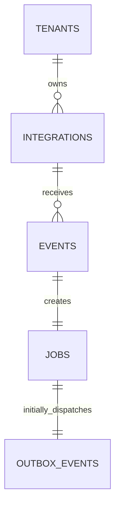

# Database design: durable order event acceptance

Status: first workflow implemented locally with an API, schema, and migration. Dispatch and job execution remain subsequent workflows.

## Workflow boundary

Accept a signed `order.created` event and atomically persist its event record, one fulfillment job, and one outbox entry. Return success only after the transaction commits.

This workflow ends at durable acceptance. Publishing the outbox entry, executing the job, and contacting the fulfillment provider belong to subsequent workflows.

V1 uses one preconfigured demo tenant and integration. Tenant ownership remains explicit. The webhook request never supplies a trusted tenant ID: the server derives ownership from the configured integration.

## Request and response

```http
POST /api/v1/webhooks/orders
X-Integration-Id: demo-store-01
X-Event-Id: evt_001
X-Signature-SHA256: <hex-encoded HMAC-SHA256 of the raw body>
Content-Type: application/json
```

```json
{
  "event_id": "evt_001",
  "type": "order.created",
  "order_id": "ord_1042",
  "resource_version": 1,
  "occurred_at": "2026-11-07T18:00:00Z",
  "data": { "item_count": 3 }
}
```

Require nonempty bounded identifiers, a positive integer resource version and item count, and a timezone-aware timestamp. Initially accept only `order.created`; reject unknown fields and duplicate JSON object keys. Header and body event IDs must agree.

The server verifies the signature over the exact received bytes using the integration's server-side secret and a constant-time comparison. Secrets and signatures must not appear in stored payloads or logs. Apply a request body limit before reading an unbounded body, and rate limits before expensive processing.

On initial acceptance and an identical retry, return `202 Accepted` with the same identifiers:

```json
{
  "event_id": "<internal UUID>",
  "external_event_id": "evt_001",
  "job_id": "<internal UUID>",
  "status": "accepted"
}
```

`accepted` describes durable receipt even if the existing job has since progressed. It does not assert fulfillment success.

## Relationships



The event/job and job/outbox relationships describe this workflow's committed result. Foreign keys and unique constraints prevent extra children; the ingestion transaction ensures the required children exist.

All primary keys are UUIDs generated by the application. Timestamps use PostgreSQL `timestamptz` and are returned in UTC. Required fields below are `NOT NULL` unless explicitly marked nullable. Use `ON DELETE RESTRICT` for these relationships to preserve history.

## Tables

### `tenants`

| Column | Type | Purpose |
| --- | --- | --- |
| `id` | uuid, primary key | Internal ownership boundary |
| `name` | text | Display name |
| `created_at` | timestamptz | Creation time |

Tenant names need not be unique. Seed one demo tenant through an explicit development seed command later.

### `integrations`

| Column | Type | Purpose |
| --- | --- | --- |
| `id` | uuid, primary key | Internal integration identity |
| `tenant_id` | uuid, foreign key | Owning tenant |
| `external_key` | text, unique | Public routing identifier, e.g. `demo-store-01` |
| `provider` | text | Initially `mock_fulfillment` |
| `signing_secret_ref` | text | Reference to server configuration; never the secret itself |
| `active` | boolean | Whether new deliveries are allowed |
| `created_at` | timestamptz | Creation time |

`external_key` is globally unique because the webhook uses it without a tenant identifier. It is a routing identifier, not a credential. Add an index on `tenant_id` for tenant-scoped integration queries.

### `events`

| Column | Type | Purpose |
| --- | --- | --- |
| `id` | uuid, primary key | Internal accepted-event identity |
| `integration_id` | uuid, foreign key | Authenticated event source |
| `external_event_id` | text | Source's stable event identifier |
| `event_type` | text | Initially `order.created` |
| `resource_id` | text | Source order ID |
| `resource_version` | bigint | Positive source version |
| `occurred_at` | timestamptz | Source timestamp, not an ordering authority |
| `received_at` | timestamptz | Server acceptance timestamp |
| `payload` | jsonb | Validated event body, including its envelope |
| `payload_sha256` | bytea | SHA-256 of a canonical representation of the validated body |

Constraints:

- Unique `(integration_id, external_event_id)` prevents duplicate logical receipt.
- Check `resource_version > 0`, `event_type = 'order.created'`, and `octet_length(payload_sha256) = 32`.
- Application validation ensures the extracted columns match the stored payload.

Use one documented canonical serialization of the validated body: sorted JSON keys, compact separators, UTF-8, and normalized UTC timestamps. Compare canonical validated content for duplicate conflicts; JSON whitespace and key ordering do not change event identity. Signature verification still uses the original raw bytes. Lock this serialization with test fixtures before implementation.

Accepted events are immutable. The ingestion service only inserts and reads them, and a database trigger rejects updates and deletes. Local development uses owner credentials; a separate runtime role without event `UPDATE` or `DELETE` permission must be provisioned before deployment. Processing state belongs on jobs.

Add an index on `(integration_id, received_at DESC, id)` for cursor-paginated history. Tenant-scoped event access joins through integrations; the integration identity is immutable after creation.

### `jobs`

| Column | Type | Purpose |
| --- | --- | --- |
| `id` | uuid, primary key | Logical fulfillment operation |
| `event_id` | uuid, unique foreign key | Originating accepted event |
| `operation_key` | text, unique | Stable identity reused by all future execution attempts |
| `state` | text | Initially `QUEUED` |
| `created_at` | timestamptz | Creation time |
| `updated_at` | timestamptz | Most recent state change |

Operation identity is `(integration_id, 'fulfillment.create', resource_id, resource_version)`. Encode that tuple unambiguously using canonical JSON before hashing it; store `fulfillment:create:<SHA-256 hex digest>` as the operation key. This avoids delimiter collisions when external identifiers contain punctuation.

For this first migration, default and constrain `state` to `QUEUED`. Expand the state constraint and define guarded transitions when implementing workers. Do not add unused lease, retry, or attempt fields yet.

### `outbox_events`

| Column | Type | Purpose |
| --- | --- | --- |
| `id` | uuid, primary key | Durable dispatch intent |
| `job_id` | uuid, foreign key | Job to publish |
| `kind` | text | Initially `JOB_READY` |
| `created_at` | timestamptz | Time dispatch intent was recorded |
| `published_at` | timestamptz, nullable | Broker publication acknowledgment time |

Unique `(job_id, kind)` permits one initial `JOB_READY` entry per job. Check `kind = 'JOB_READY'` initially. A queue message will contain the job ID; no separate copy of the event payload is necessary here.

Add a partial index on `(created_at, id) WHERE published_at IS NULL` for pending dispatch. Later, a dispatcher publishes first and marks publication afterward; crashes between those actions may publish duplicates. `published_at` never proves job execution or remote completion.

## Ownership and query boundaries

Keep ownership normalized for these five tables: jobs inherit ownership through events, events through integrations, and outbox entries through jobs. Avoid repeated `tenant_id` columns that can disagree with their parent.

Operator-facing queries must constrain the owning integration's `tenant_id`. Internal workers load jobs by server-generated ID and derive integration and tenant from that chain. If future query performance requires repeated ownership columns, introduce matching composite foreign keys in a migration.

| Query | Supporting key or index |
| --- | --- |
| Resolve an incoming integration key | Unique `integrations(external_key)` |
| Find a tenant's integrations | `integrations(tenant_id)` |
| Detect an event retry | Unique `events(integration_id, external_event_id)` |
| List an integration's event history | `events(integration_id, received_at DESC, id)` |
| Return a duplicate event's job | Unique `jobs(event_id)` |
| Prevent duplicate business work | Unique `jobs(operation_key)` |
| Poll pending outbox entries | Partial index on unpublished entries |
| Find a job's initial dispatch intent | Unique `outbox_events(job_id, kind)` |

## Ingestion transaction and concurrency

Enforce body and rate limits before opening a transaction. The implementation then opens a short database transaction to lock the integration configuration, verify authentication, and validate the payload before inserting business records. This keeps configuration stable during signature verification. Inside the transaction:

1. Lock and recheck the integration's active configuration with a shared row lock. Administrative deactivation or secret rotation must use a conflicting update lock so acceptance has a defined order relative to configuration changes.
2. Insert the event using `INSERT ... ON CONFLICT (integration_id, external_event_id) DO NOTHING RETURNING id`.
3. If inserted, create its `QUEUED` job and `JOB_READY` outbox entry.
4. If the event already exists, load it in a subsequent statement and compare canonical payload hashes. An identical event returns the existing event and job. Different content is a conflict.
5. Commit, then send the response.

Use PostgreSQL's default `READ COMMITTED` isolation initially. A concurrent duplicate insert waits for the competing transaction; the subsequent read sees its committed event. Do not catch a uniqueness error and continue querying an aborted transaction.

Two different event IDs might describe the same operation. For this first workflow, the unique operation key rejects the second with `409 Conflict`, rolling back its new event and outbox intent. The source contract requires a stable event ID for retries. Retaining multiple distinct events for one operation would require an explicit event-to-job association design later.

Do not make broker or provider calls inside this transaction. A webhook success response requires a successful commit of all three records. Uniqueness constraints enforce at most one; the transaction and ingestion service enforce their atomic creation.

## Error and retry semantics

| Condition | HTTP outcome | Durable business effect |
| --- | --- | --- |
| Unknown/inactive integration or invalid signature | `401` with a generic authentication error | None |
| Body exceeds configured limit | `413` | None |
| Rate limit exceeded | `429` | None |
| Invalid JSON, unsupported schema/type, or mismatched event IDs | `422` | None |
| Existing event ID with different validated content | `409` | Existing records unchanged |
| Different event ID reuses a logical operation | `409` | Second ingestion rolls back |
| Identical authenticated retry | `202`, existing IDs | No new records |
| Database unavailable or transaction fails | `503` | No acceptance promised; sender retries |
| Process dies after commit but before response | No response | Retry returns existing IDs |
| Broker unavailable | `202` after database commit | Pending outbox remains durable |

Rejected requests produce sanitized structured logs with a correlation ID. Do not log secrets or full payloads. The initial synthetic payload contains no customer details; retention periods for payloads and operational evidence must be decided before a hosted demo.

## Acceptance tests for implementation

Use real PostgreSQL integration tests for database behavior:

1. A valid signed event returns `202` and creates exactly one event, job, and outbox entry.
2. Ten sequential retries return the same IDs and keep all three row counts at one.
3. Concurrent retries converge on the same IDs without unexpected server errors.
4. Equivalent JSON with different key order/whitespace deduplicates after valid signature verification.
5. Changed content under the same event ID returns `409` and preserves the original records.
6. Different event IDs for the same operation return a conflict without partially accepting the second event.
7. Invalid signatures, inactive integrations, malformed payloads, duplicate JSON keys, and header/body mismatches create no business rows.
8. Injected failures after each insertion roll back all ingestion rows.
9. Retrying after a committed transaction with a lost response returns the original IDs.
10. Acceptance works with the broker offline, leaving an unpublished outbox entry.
11. Database triggers reject event update/delete operations. Tenant-scoped read endpoints and dedicated runtime credentials belong to subsequent workflows and must be tested when introduced.

## Next implementation slice

The next workflow is specified in [Fulfillment workflow](fulfillment-workflow.md): dispatch a queued job, create one simulated shipment, and verify the provider state.

The FastAPI skeleton, configuration, PostgreSQL development service, SQLAlchemy models, first Alembic migration, and signed ingestion endpoint are implemented. Worker execution and the fulfillment provider follow after this slice is reviewed.
